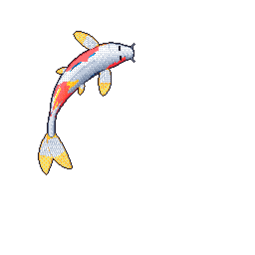

<h3><code>aryan4859@github ~ $ whoami</code></h3>
<table>
<tr>
<td valign="top"></td>
<td valign="top"></td>
</tr>
</table>
 

 
<h3><code>aryan4859@github ~ $ ./contributions.sh</code></h3>

<h3><code>aryan4859@github ~ $ ./links.sh</code></h3>

<b>Cybersecurity</b>

